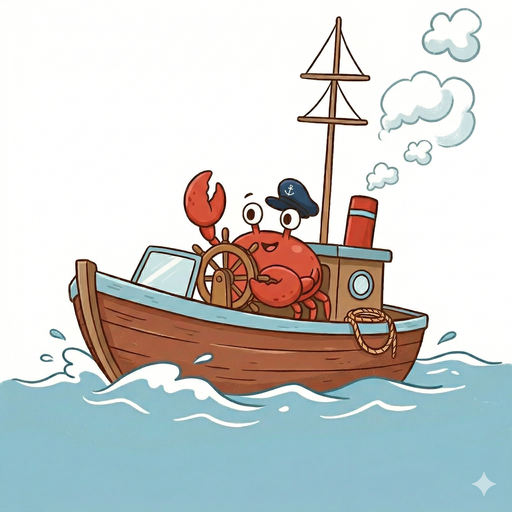

**Languages:** [English](../en/README.md)
<!-- sakoku-ignore-next-line -->
[日本語](../ja/README.md) · [简体中文](../zh/README.md) · [Index](README.md)

# cruise

<p align="center">
  
</p>

Cruise is a YAML-based AI workflow orchestrator.

Cruise semi-deterministically automates declarative workflows through planning → approval → test writing → implementation → testing → review → optional PR creation and after-PR-like tasks. It supports passing variables between steps, conditional branching, and loops. Built on Jcode, it uses very few resources. It also supports Claude and OpenCode SDK backends and custom CLI commands such as `codex exec`.

## Documentation topics

All locale editions use the same topic filenames. Keep guide changes synchronized across English, Japanese, and Simplified Chinese.

- [Installation](installation.md) — OS-specific installation, updates, and managed provider CLIs.
- [Usage](usage.md) — WebUI, CLI examples, herdr, TUI, and workflow packages.
- [CLI reference](cli-reference.md) — commands, arguments, options, language settings, and notifications.
- [Sessions](sessions.md) — lifecycle, workspace modes, isolation, recovery, and parallel execution.
- [Configuration](configuration.md) — config resolution, defaults, settings, and prompt language.
- [SDK](sdk.md) — backends, authentication, permissions, and tool restrictions.
- [Steps](steps.md) — step types, after-PR automation, and variables.
- [Workflow control](workflow-control.md) — flow control, flags, conditions, groups, and workflow composition.
- [Workflow examples](workflow-examples.md) — complete development flow and simple automatic commit flow.
- [GitHub Actions](github-actions.md) — Action setup, commands, providers, security, and troubleshooting.
- [Telemetry](telemetry.md) — OpenTelemetry configuration, exported data, and privacy notes.

<a id="development-build"></a>
## Development build

To test the launcher locally, build both binaries. The `cruise` launcher starts the adjacent `cruise-runtime`, so both are needed.

```sh
cargo build --bin cruise --bin cruise-runtime
```

<a id="support"></a>
## Support

If Cruise is useful to you, consider [sponsoring smartcrabai](https://github.com/sponsors/smartcrabai) to support its development and maintenance.
